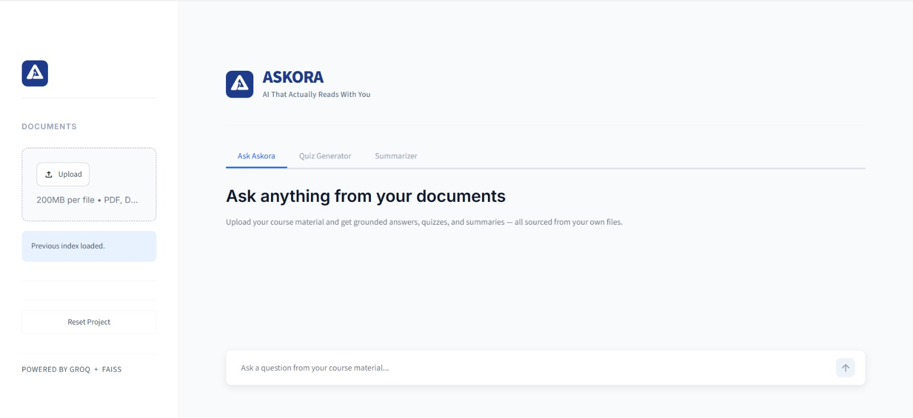
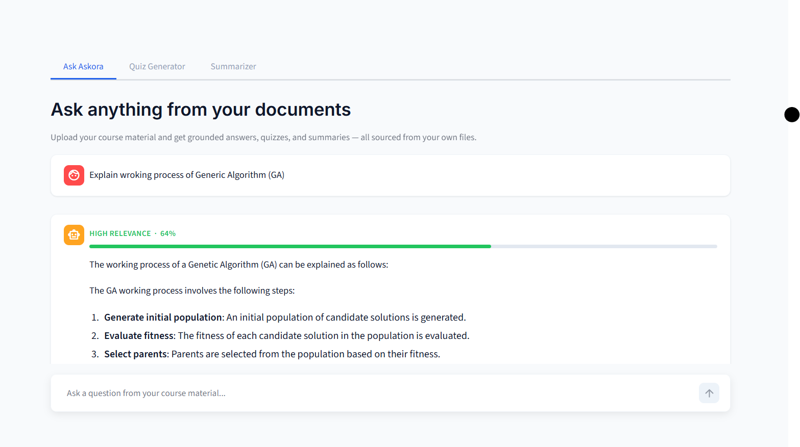
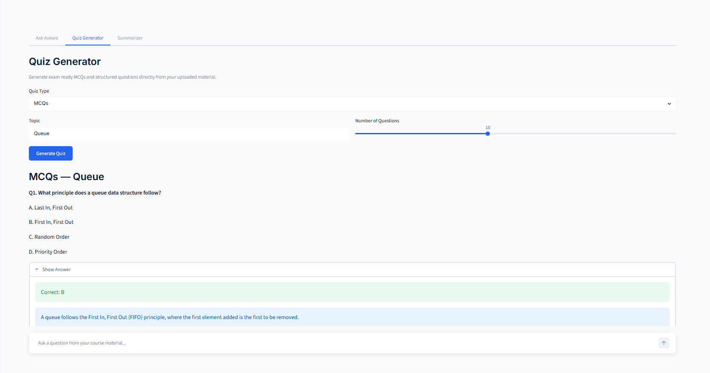
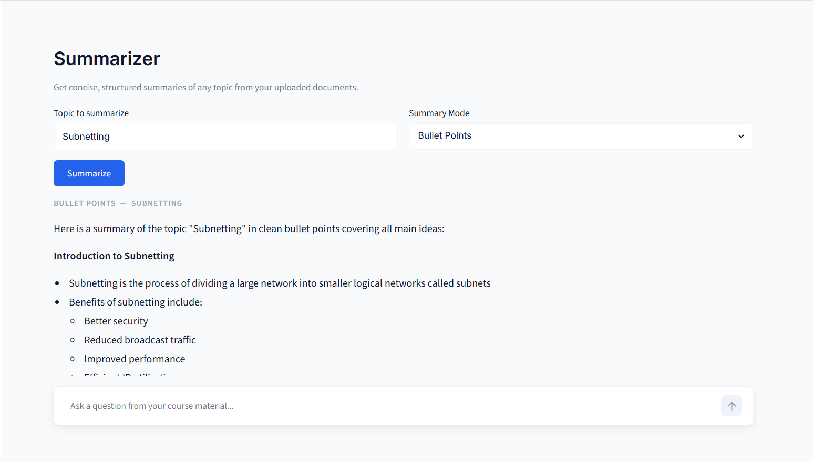
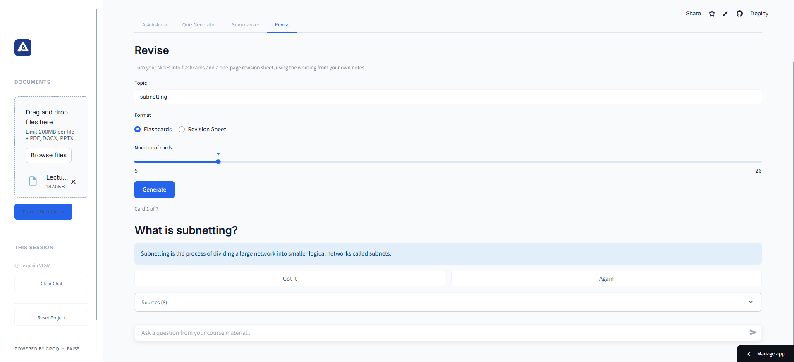

# Askora: AI Academic Assistant

> AI That Actually Reads With You

**Live Demo:** https://askora-bot.streamlit.app/

---

## Overview

Askora is an AI study assistant built with Python and Streamlit. Students upload their own lecture material (PDF, DOCX or PPTX), and Askora answers questions from it, builds quizzes, writes summaries, and turns slides into flashcards and revision sheets. It uses Retrieval-Augmented Generation (RAG), so every answer comes from the uploaded files and shows the source file and page number.

---

## Key Features

- **Ask Askora:** Ask questions in plain language and get answers with source file, page number and a short snippet of the matching text.
- **Confidence Score:** Each answer shows a color-coded relevance bar (green, orange or red), so students can see how well the notes support the answer.
- **Quiz Generator:** MCQs and 2, 5 and 10 mark questions with model answers, created from the uploaded material.
- **Summarizer:** Detailed, Bullet Points or ELI5 summaries of any topic.
- **Revise:** Flashcards that use the wording from the slides. Cards marked "Again" come back at the end of the deck. A one-page revision sheet with definitions, lists to memorize, comparisons and likely exam questions can be downloaded.
- **Multi-Document Search:** Search across several files at once.
- **Scanned PDF Support:** OCR fallback for image-based pages.
- **Formats:** PDF, DOCX and PPTX.

---

## Tech Stack

| Technology | Purpose |
|---|---|
| Python | Core application logic |
| Streamlit | Web interface |
| Groq API | Fast LLM inference |
| GPT OSS 120B | Language model used for answers, quizzes, summaries and revision material |
| FAISS | Vector similarity search (cosine similarity) |
| Sentence Transformers | Text embeddings (all-MiniLM-L6-v2) |
| LangChain Text Splitters | Document chunking |
| PyMuPDF | PDF text extraction |
| Tesseract OCR + pdf2image | Text extraction from scanned PDFs |
| python-docx, python-pptx | Word and PowerPoint text extraction |

---

## How It Works

```
Uploaded files (PDF / DOCX / PPTX)
            |
   Text extraction (OCR for scanned pages)
            |
   Chunking with overlap
            |
   Embeddings (all-MiniLM-L6-v2)
            |
   FAISS index (cosine similarity)
            |
   Semantic retrieval of the top matching chunks
            |
   GPT OSS 120B via Groq
            |
   Answer, quiz, summary or flashcards
   with confidence score and sources
```

---

## Project Structure

```
Askora/
|-- app.py
|-- config.py
|-- requirements.txt
|-- packages.txt
|-- .gitignore
|-- README.md
|-- .streamlit/
|   `-- config.toml
|-- screenshots/
|   |-- interface.png
|   |-- ask.png
|   |-- quiz.png
|   |-- summarizer.png
|   `-- revise.png
`-- src/
    |-- __init__.py
    |-- embeddings.py
    |-- pdf_processor.py
    |-- quiz_generator.py
    |-- retriever.py
    |-- revision.py
    |-- summarizer.py
    `-- style.css
```

---

## Screenshots

### Main Interface


### Ask Questions


### Quiz Generator


### Summarizer


### Revise


---

## Run Locally

### 1. Clone the repository

```bash
git clone https://github.com/MehXarii/Askora.git
cd Askora
```

### 2. Create a virtual environment

Windows:

```bash
python -m venv venv
venv\Scripts\activate
```

### 3. Install dependencies

```bash
pip install -r requirements.txt
```

### 4. Install OCR tools (only needed for scanned PDFs)

- Install [Tesseract OCR](https://github.com/tesseract-ocr/tesseract) and [Poppler](https://github.com/oschwartz10612/poppler-windows), and make sure both are available on your system PATH.

### 5. Add your API key

Create a `.env` file in the project root:

```env
API_KEY=your_groq_api_key_here
```

Get a free key at [console.groq.com](https://console.groq.com). Never commit the `.env` file.

### 6. Start the app

```bash
streamlit run app.py
```

---

## Deploy on Streamlit Cloud

1. Push the project to GitHub.
2. Go to [share.streamlit.io](https://share.streamlit.io) and create a new app from your repository, with `app.py` as the main file.
3. Open Advanced settings, then Secrets, and add:

```toml
API_KEY = "your_groq_api_key_here"
```

4. Deploy. The `packages.txt` file installs Tesseract and Poppler on the server automatically.

---

## Model Configuration

The model name is set in `config.py`:

```python
LLM_MODEL = "openai/gpt-oss-120b"
```

Groq changes the models available to each account over time. If the app shows a "model not available" message, it lists the models your key can use. Copy one of those names into `LLM_MODEL`.

---

## Use Cases

- Exam preparation from lecture slides
- Quick revision with flashcards and one-page sheets
- Practice questions in the 2, 5 and 10 mark format
- Searching across several course files at once

---

## Security

API keys are kept in environment variables or Streamlit Secrets and are excluded from version control through `.gitignore`. Never commit keys to the repository.

---

## Future Improvements

- Urdu explanations
- Exporting quizzes as Word or PDF files
- User accounts and saved study sessions
- Study progress tracking

---

## Author

**Mehak Ansari**
BSCS, University of Central Punjab, Rawalpindi

GitHub: [@MehXarii](https://github.com/MehXarii)

---

## License

This project is available for educational and portfolio purposes.